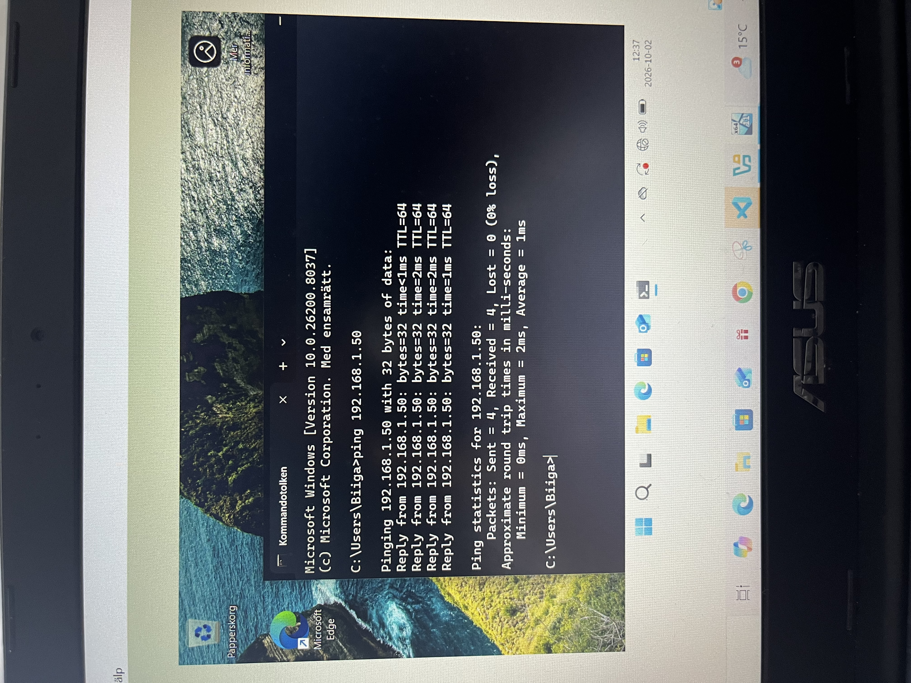
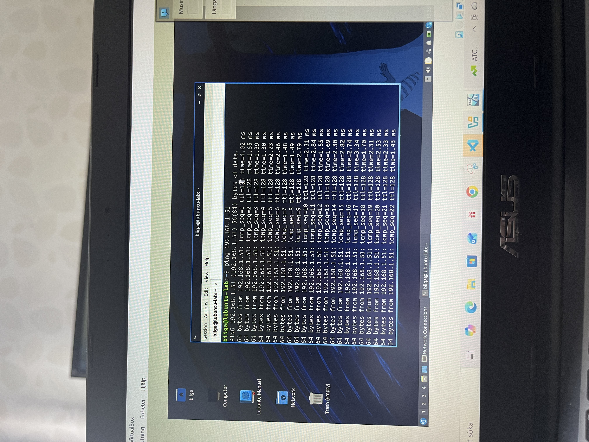
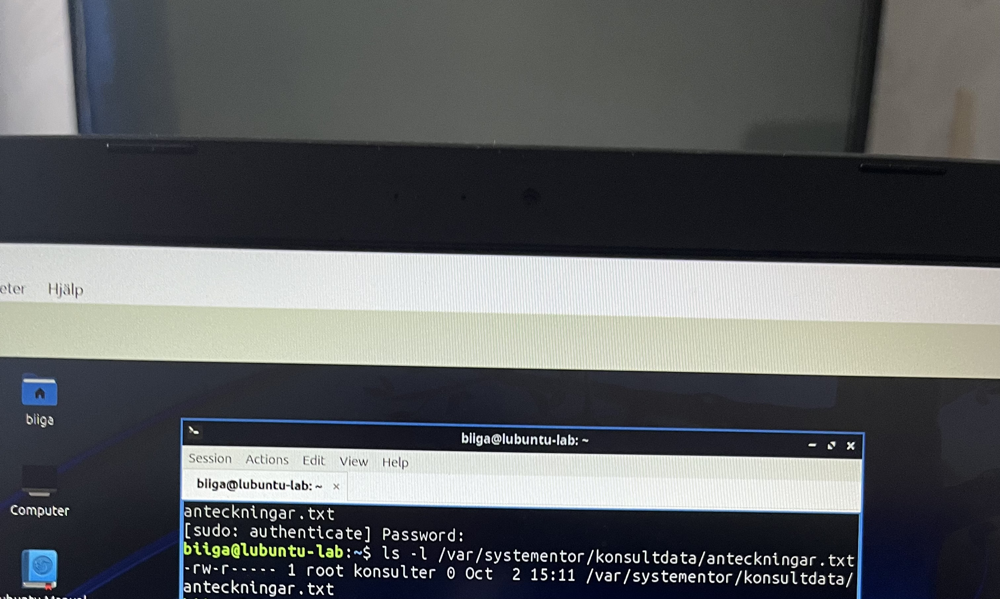

# Labbdokumentation
## 1. Titel och introduktion
Namn: Abbubakar Abdullahi
Datum: 2026-09-30
Kurs: Introduktion till yrkesrollen och grunderna i IT-infrastruktur

## 2. Labbmiljö och nätverk
I denna labb så har jag användt mig utav två virtuella maskiner i virtual box, vilket var windows och lubuntu. Jag har konfiguerat båda maskinerina inom samma nätverk för att göra det möjligt för maskinerna att kommunicera med varandra. 

## Nätverkskonfiguration

| Hostname | Operativsystem | IP-adress | Subnätmask | Default gateway   |
|----------|----------------|-----------|------------|-------------------|
| lubuntu-lab | Linux   | 192.168.1.50 | 255.255.255.0(24) | Ingen |
| Skoldator   | Windows | 192.168.1.51 | 255.255.255.0(24) | ingen |
## Kommunikationen mellan Lubuntu och Windows
Jag kontrollerade kommunikationen mellan båda maskinerna genom att pinga, alltså använda ping för att bekräfta kommunikation. Detta innebär alltså att jag pingade från Windows till Lubuntu och vice versa. Kommunikationen bekräftades och blev lyckat på båda fronter.

## Linux - filer och behörigheter
Jag skapade en katalog i Lubuntu och döpte den till "Konsultdata", samt en textfil som jag döpte till "anteckningar". Efter detta så skapade jag en grupp, döpt till "Konsulter" och konfiguerade behörigheterna för att begränsa åtkomsten.
### Kommandon och behörigheter
När jag skapade katalogen så använde jag:
`sudo mkdir -p /var/systementor/konsultdata`
När jag skapade textfilen så använde jag:
`sudo touch /var/systementor/konsultdata/anteckningar.txt`
När jag skapade konsulter gruppen så använde jag:
`sudo groupadd konsulter`
När jag skulle koppla ihop kataloger till konsult-gruppen så använde jag:
`sudo chown :konsulter /var/systementor/konsultdata`
När jag skulle konfiguera behörigheterna i katalogen så använde jag:
`sudo chmod 750 /var/systementor/konsultdata`
När jag skulle konfiguera behörigheterna i texfilen så använde jag:
`sudo chmod 640 /var/systementor/konsultdata/anteckningar.txt`
När jag skulle lägga till min egen användare i konsulter-gruppen så använde jag:
`sudo usermod -aG konsulter biiga`
### Felsökning
I samband med att jag skulle kontrollera behörigheterna för textfilen så fick jag felmeddelandet "Permission denied", vilket berodde på att min egen användare inte hade tillgång via konsultgruppen.
För att lösa detta problem så la jag till min användare, "biiga", i konsultgruppen genom att använda `sudo usermod -aG konsulter biiga`. När jag gjorde klart det så behövde jag starta om Lubuntu för att det skulle fungera.
### Verifiering av behörigheter
När jag gjorde klart dessa ändringar så kontrollerade jag behörigheterna på nytt. Då fick jag svaret att katalogen hade behörighten 750 och textfilen 640.
