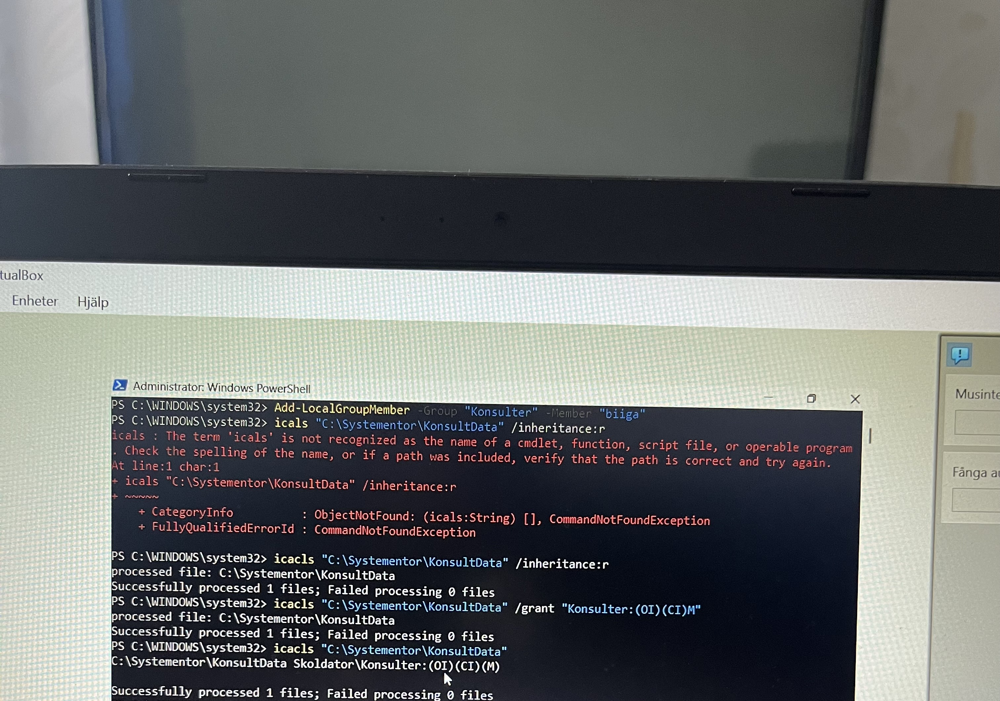
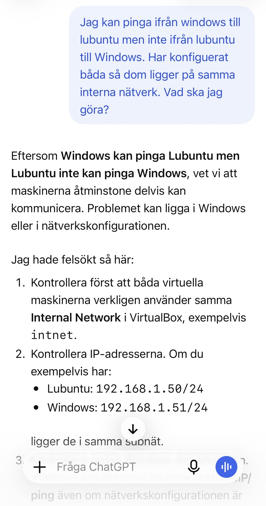
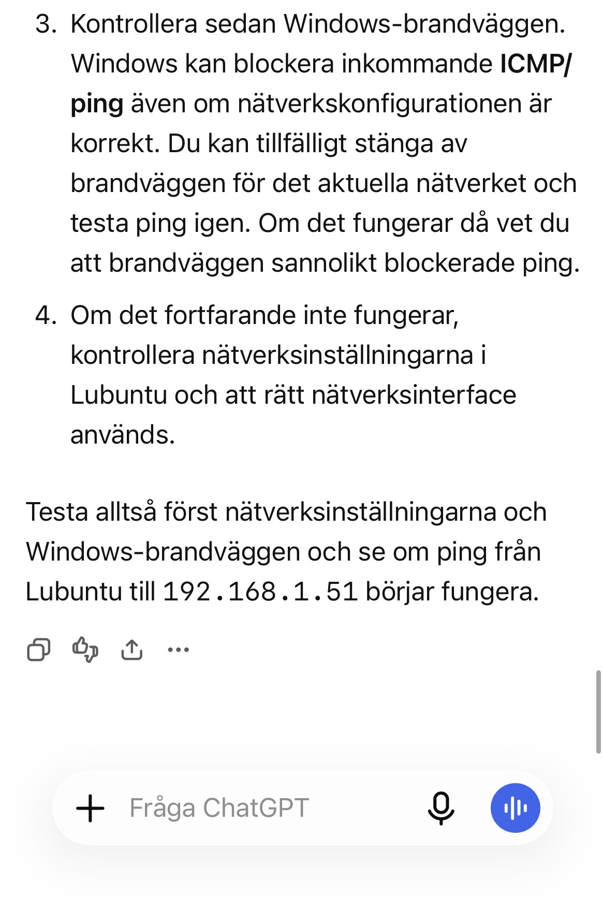

# Labbdokumentation
## 1. Titel och introduktion
Namn: Abbubakar Abdullahi
Datum: 2026-09-30
Kurs: Introduktion till yrkesrollen och grunderna i IT-infrastruktur

## 2. Labbmiljö och nätverk
I denna labb så har jag användt mig utav två virtuella maskiner i virtual box, vilket var windows och lubuntu. Jag har konfiguerat båda maskinerna inom samma nätverk för att göra det möjligt för maskinerna att kommunicera med varandra. 

## Nätverkskonfiguration

| Hostname | Operativsystem | IP-adress | Subnätmask | Default gateway   |
|----------|----------------|-----------|------------|-------------------|
| lubuntu-lab | Linux   | 192.168.1.50 | 255.255.255.0(24) | Ingen |
| Skoldator   | Windows | 192.168.1.51 | 255.255.255.0(24) | ingen |
## Kommunikationen mellan Lubuntu och Windows
Jag kontrollerade kommunikationen mellan båda maskinerna genom att pinga, alltså använda ping för att bekräfta kommunikation. Detta innebär alltså att jag pingade från Windows till Lubuntu och vice versa. Kommunikationen bekräftades och blev lyckat på båda fronter.

## Linux - filer och behörigheter
Jag skapade en katalog i Lubuntu och döpte den till "Konsultdata", samt en textfil som jag döpte till "anteckningar". Efter detta så skapade jag en grupp, döpt till "Konsulter" och konfiguerade behörigheterna för att begränsa åtkomsten.
### Kommandon och behörigheter
När jag skapade katalogen så använde jag:
`sudo mkdir -p /var/systementor/konsultdata`
När jag skapade textfilen så använde jag:
`sudo touch /var/systementor/konsultdata/anteckningar.txt`
När jag skapade konsulter gruppen så använde jag:
`sudo groupadd konsulter`
När jag skulle koppla ihop kataloger till konsult-gruppen så använde jag:
`sudo chown :konsulter /var/systementor/konsultdata`
När jag skulle konfiguera behörigheterna i katalogen så använde jag:
`sudo chmod 750 /var/systementor/konsultdata`
När jag skulle konfiguera behörigheterna i texfilen så använde jag:
`sudo chmod 640 /var/systementor/konsultdata/anteckningar.txt`
När jag skulle lägga till min egen användare i konsulter-gruppen så använde jag:
`sudo usermod -aG konsulter biiga`
### Felsökning
I samband med att jag skulle kontrollera behörigheterna för textfilen så fick jag felmeddelandet "Permission denied", vilket berodde på att min egen användare inte hade tillgång via konsultgruppen.
För att lösa detta problem så la jag till min användare, "biiga", i konsultgruppen genom att använda `sudo usermod -aG konsulter biiga`. När jag gjorde klart det så behövde jag starta om Lubuntu för att det skulle fungera.
### Verifiering av behörigheter
När jag gjorde klart dessa ändringar så kontrollerade jag behörigheterna på nytt. Då fick jag svaret att katalogen hade behörighten 750 och textfilen 640.

## Windows -filer och behörigheter
Jag skapade en katalog C:\Systementor\KonsultData och en textfil, anteckningar.txt. Sedan skapade jag gruppen Konsulter samt la till min egen användare, biiga. Slutligen så konfiguerade jag behörigheten i Powershell.
### Konfiguration av behörigheter
Jag tog bort ärvda behörigheter genom att använda:
`icacls "C:\Systementor\KonsultData" /inheritance:r`
Jag gav gruppen konsulter behörigheten Modify genom att använda:
`icacls "C:\Systementor\KonsultData" /grant "Konsulter:(OI)(CI)M"`
### Felsökning
I samband med att jag skulle konfiguera behörigheterna så råkade jag först skriva icals istället för icacls, vilket ledde till ett felmeddelande. Efter rättning utav kommandot så fungerade det.

## AI-stöd och kritisk utvärdering
Jag använde mig utav chatGPT som stöd i denna uppgift. Chat GPT fick vara mitt stöd i att främst förklara uppgiften och bryta ner det så att det var enklare att förstå. Något som stack ut var när jag fastnade i nätverkskonfigurationen i Lubuntu. Windows fungerade bra och jag pingade till Lubuntu, men det gick inte att pinga ifrån Lubuntu till Windows och jag förstod inte riktigt varför.
## Exempel på AI-användning  
Jag förklarade för AI att jag kunde pinga ifrån windows till lubuntu utan konstigheter, men att det inte gick att pinga ifrån lubuntu till windows. Sedan så frågade jag vad jag möjligen kan göra eller kika på för att lösa detta. Svaret jag fick var väldigt vagt och ledde egentligen inte till att jag lyckades lösa problemet, utan tvärtom. Massvis med tid slösades på att gå runt i cirklar. AI bad mig dels att dubbelkolla ifall maskinerna verkligen låg på samma nätverk och att IP addresserna var korrekta, vilket jag redan hade trippelkollat innan jag vände mig till AI. Detta ledde till att jag kontrollerade sådant som redan var konfiguerat, ett x antal gånger. AI nämnde även att brandväggen i Windows kunde vara en orsak, utan att förstå problemet. Inte nog med det, så nämnde AI att jag tillfälligt kunde stänga ner brandväggen i Windows, vilket fick mig att bli väldigt kritisk. 
På grund utav detta, så kunde jag inte helt lita på AI:s svar och fick felsöka på egen hand. När jag felsökte så kontrollerade jag konfigurationen steg för steg. Sedan bestämde jag mig för att testa skapa en ny nätverksprofil i Lubuntu, på samma interface som innan och samma ip adress. Därefter fungerade det. Detta var ett typiskt "stäng av och sätt på datorn"- situation, men ett tydligt exempel på att AI inte kan lösa alla våra problem.
### Prompt och AI-svar

